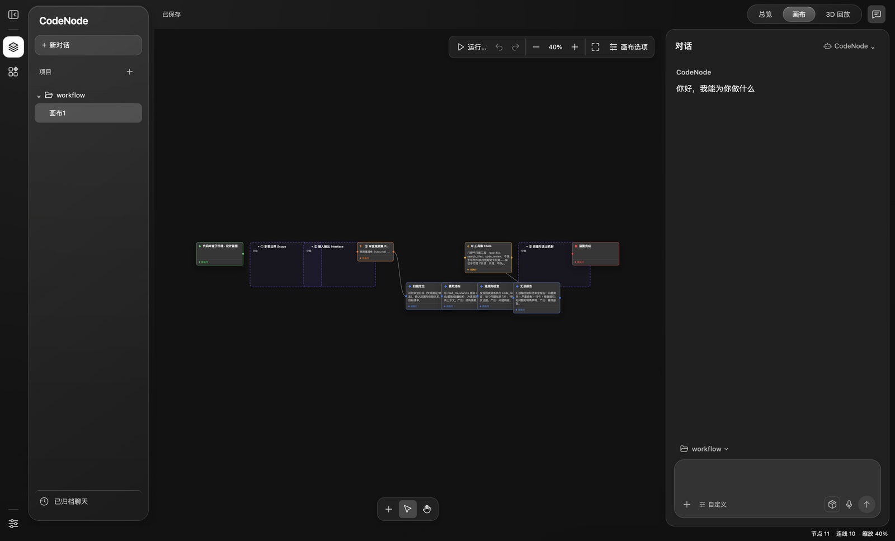
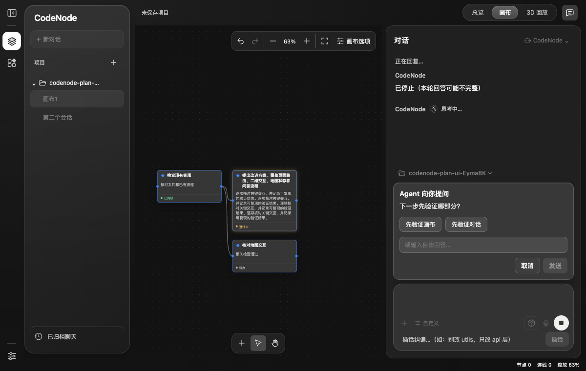
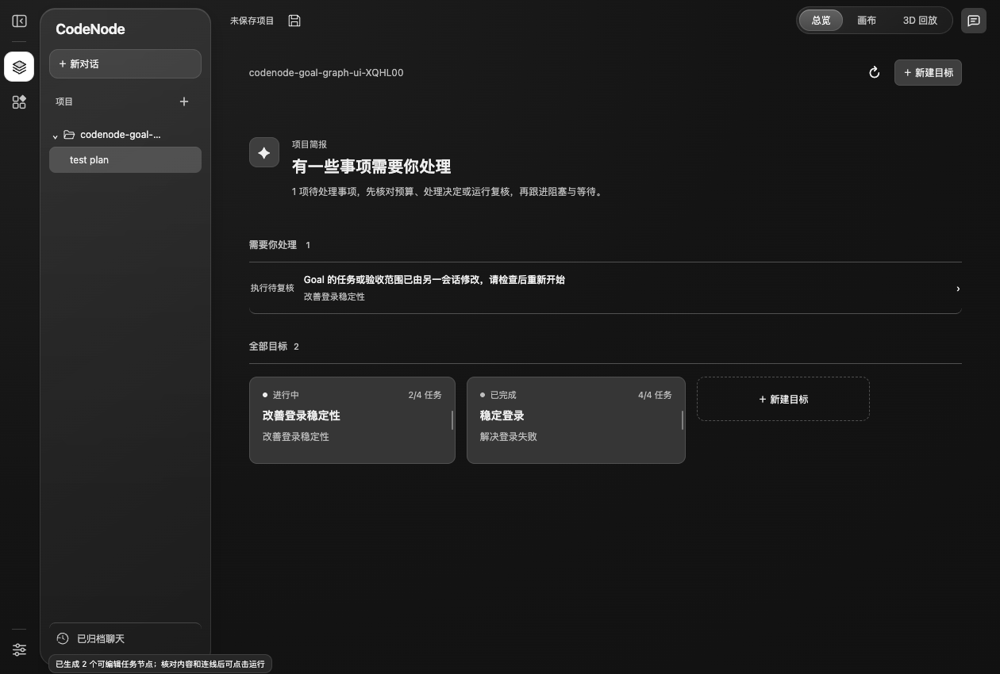
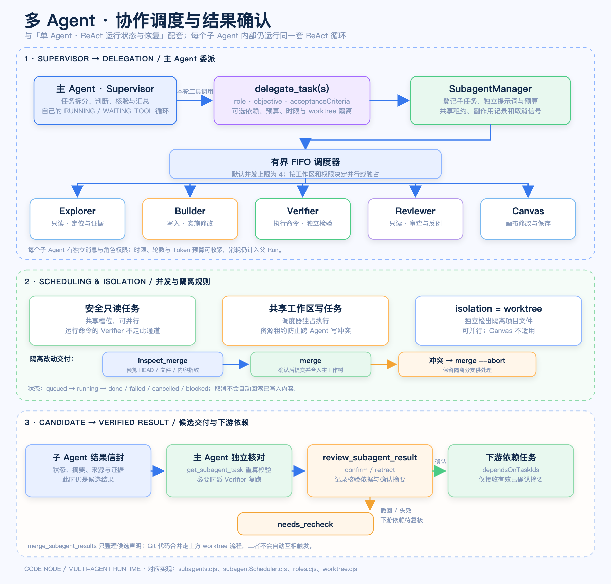

# CodeNode

[English](README.md) · [简体中文](README.zh-CN.md)

CodeNode is a desktop workbench for using a coding agent in a local repository. Ask a question in chat, lay out dependent tasks on the canvas, and open the run record to see which files the agent read, what it changed and which checks passed. Start with “Where does this app start?” or take a change across several files from investigation through verification.



*Captured on November 27, 2026 from the merged desktop app with the repository’s workflow.cnode example open.*

## Why use CodeNode?

| When you need to… | What the workbench gives you |
| --- | --- |
| Decide whether a fix is ready to merge | Expand the file diff in chat and inspect tool output. Give the goal a concrete acceptance condition, such as reopening a saved project after restarting, then check the test result. |
| Keep track of a change spanning several files | Follow the plan on the canvas to see which steps are active and which depend on earlier work. The goal overview collects blockers and requests for review. |
| Pick up after a dropped connection | Events, checkpoints and a side-effect ledger record what happened. Recovery checks previous results and surfaces uncertain writes for review before continuing. |
| Verify an implementation independently | Delegate investigation, editing, testing and review to distinct roles. Artifact fingerprints help identify conclusions that need checking again when a file changes. |

## How to use CodeNode

Install Node.js 22.12 or newer on a machine with a desktop environment. These commands start Vite and Electron.

```sh
git clone https://github.com/yimi528/CodeNode.git
cd CodeNode
npm ci
npm run dev
```

1. **Open a project.** Select a source folder from the project sidebar, or open an existing `.cnode` project. To explore the example pictured above, open this repository’s `workflow.cnode`.
2. **Connect a model.** Open the model connection control beside the chat input. Choose a provider, supply its API key if needed, and enter the endpoint for a custom provider. Connect, select a model and save the connection. The backend selector also supports installed external agents. [Backend configuration](docs/backends.md)
3. **Try a question you can verify.** In this repository, ask “Find the Fit Canvas button (适应画布). Which function runs when I click it? Give me the file path.” Open that file to check the answer. For an edit, add the scope and a testable acceptance condition.
4. **Track a longer task.** Use `/plan` to generate a plan and follow its steps and dependencies on the canvas. For work you want to track across runs, open the overview, create a goal and enter its acceptance criteria. Review the changed files and test output, and respond to requests for approval in the workbench. [Canvas and goals](docs/canvas-and-goals.md)

<details>
<summary>See a plan in progress</summary>



In this UI regression example, the canvas shows completed, active and pending steps. The agent asks which part to verify first in the panel on the right.

</details>



*The current goal overview with sample data from the UI regression suite. The attention list identifies a task to review, and each card shows progress toward its goal.*

## Architecture

The React renderer handles chat, the canvas and goal views. It sends requests over IPC through the preload bridge. With the built-in backend, the Electron main process drives model calls, tools and run persistence, then streams text, tool results and state changes back to the UI.

### The single-agent ReAct loop


Consider the Fit Canvas question. In `RUNNING`, the model requests a source search. The runner enters `WAITING_TOOL`, validates the arguments, executes the search and feeds the matches back into context. On the next turn the model can read the matching file and answer from its contents. An action requiring approval or more information enters `WAITING_USER` until the user responds. A final answer, an exhausted budget, a run error and cancellation each lead to a distinct terminal state.

After an interruption, checkpoints and the side-effect ledger determine which steps can proceed and which outcomes need review. Continuing creates a new run and preserves the original record. [Agent loop](electron/agent.cjs) · [Run states and recovery](docs/run-recovery.md)

### How multiple agents collaborate



1. **Delegate.** The main agent gives each subtask an objective, a role and acceptance criteria, with dependencies where needed. For a project recovery bug, an Explorer might locate the startup path, a Builder edit it, a Verifier run the regression and a Reviewer check edge cases. The Canvas role edits the workflow itself.
2. **Schedule and isolate.** Each child runs the same ReAct loop with its own conversation, permissions and budget. The default concurrency limit is four. Safe read-only tasks can run in parallel. A writer gets exclusive access to a shared workspace, or can work in its own Git worktree alongside other isolated changes.
3. **Verify and hand off.** A child returns a candidate summary with sources and artifacts. The main agent checks fingerprints against disk and can ask a Verifier to rerun a test. Only confirmed, still-valid summaries pass to dependent tasks. Worktree changes go through a merge preview and confirmation. Conflicts leave the isolated work available for review. [Scheduler](electron/subagentScheduler.cjs) · [Multi-agent collaboration](docs/multi-agent.md)

## Agent evaluation

| Date and conditions | Result | Interpretation |
| --- | --- | --- |
| November 1, 2026, scripted model responses with real tools and file operations | 14 scenarios run three times each, 42/42 passed | Exercises framework behavior including edits, recovery, cancellation and budgets. |
| November 2, 2026, frozen source with live `deepseek-chat` | 11 tasks run three times each, 32/33 passed the assertions in use. The overall gate failed. | Review found that the grader accepted an incorrect word count. The pass count measures that grader’s decisions and cannot establish answer accuracy. |

**A repair you can reproduce.** On November 27, 2026 we reran `edit-then-run-tests` on the merged version. The sample project’s addition function used subtraction. In each trial CodeNode read the implementation, edited only `pkg/math.cjs` and ran the existing tests. A separate grader compared the workspace before and after the edit, then reran assertions including `add(2, 3) === 5`. All three fresh workspaces passed with the test file intact. Model decisions in this case were scripted. [Task and grading criteria](scripts/eval/agent-eval-tasks.cjs)

To reproduce this case, run the following command.

```sh
npm run eval:agent:repeat -- --mode=offline --task=edit-then-run-tests --trials=3
```

Run `npm run eval:agent:repeat -- --trials=3` to repeat the offline suite on your checkout and inspect the per-trial records and assertions. [Evaluation methods and historical results (Chinese)](docs/agent-evals-anthropic.zh-CN.md)

## Code development guidelines

| What you are changing | Where it belongs and how to check it |
| --- | --- |
| UI and interactions | Keep React / TypeScript components and state in `src/`. Request filesystem and system operations through the IPC interface exposed by preload. For a canvas change, exercise the actual pointer or keyboard interaction in Electron and check the resulting state. |
| Main process and agent tools | Keep window management, IPC and the run loop in `electron/`, and tool implementations in `electron/tools/`. Use the existing tool registration and execution path so argument validation, permission checks and run records cover the new behavior. |
| Regression tests | Put tests that need no display in `scripts/core/` and window interaction tests in `scripts/ui/`. Exercise the normal entry point and assert an observable result. For an editing tool, read the file back from disk, rerun the project test independently and check its exit code. |

**Formatting.** Use UTF-8, LF line endings and a final newline. Indent TypeScript, JavaScript and YAML with two spaces. When editing a bilingual guide, keep its steps, commands and figures in sync across both versions. [Editor configuration](.editorconfig) · [Line-ending rules](.gitattributes)

**Branches and commits.** Name working branches `<type>-YYYYMMDD-<topic>` using the creation date and a lowercase, hyphenated topic, for example `docs-20261127-workbench-guide`. Prefix commit subjects with `feat:`, `fix:`, `refactor:`, `docs:` or `chore:`. Explain the motivation and verification in the body. Target `main` with pull requests and include the commands you ran and their results. Exclude generated evaluation reports, runtime logs and temporary builds from commits. [Pull request template](.github/pull_request_template.md)

**Development log.** For each change to source, configuration, scripts, tests or documentation, append an entry to `docs/development-log/YYYY-MM-DD.md`. Use Shanghai time in `YYYY-MM-DD HH:mm:ss CST` format. Keep the three required headings, “修复的 Bug” (bugs fixed), “更新内容” (changes) and “验证结果” (verification). Write “无” when a section has no entry. [Log format](docs/development-log/README.md)

**Before committing.** Use `npm run test:list` to find the affected tests, then run the checks below. For changes to the UI, canvas or Electron windows, also run `npm run test:display`.

```sh
npm run test:development-log
npm run verify
```

`verify` runs `npm run build`, `npm run check:js` and `npm test` in sequence. These cover the renderer build, static checks on the main process and scripts, and the core regression suite. [Contribution guide](CONTRIBUTING.md) · [Documentation index](docs/README.md)

## License

[Apache License 2.0](LICENSE)
