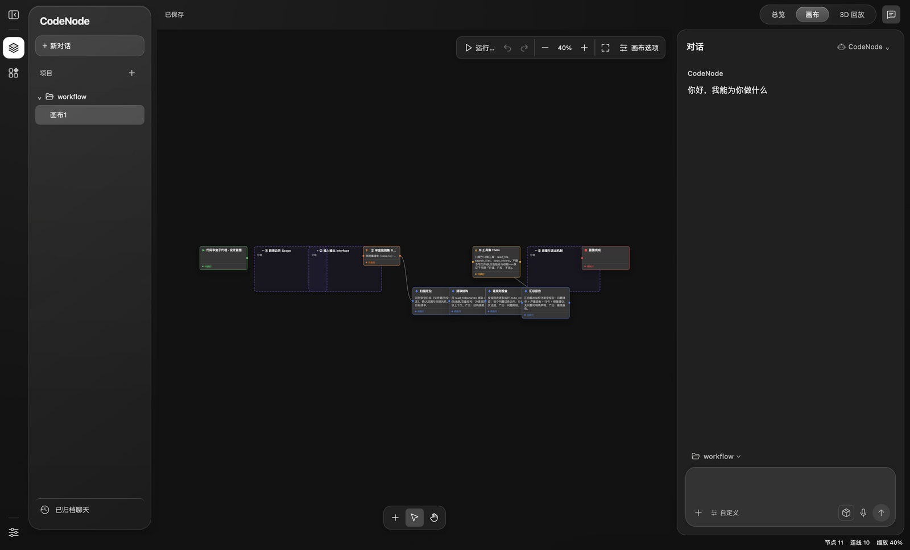
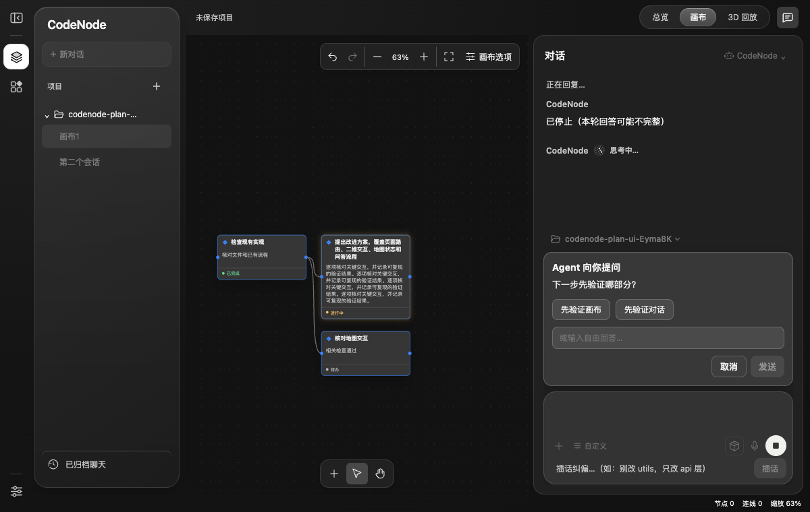
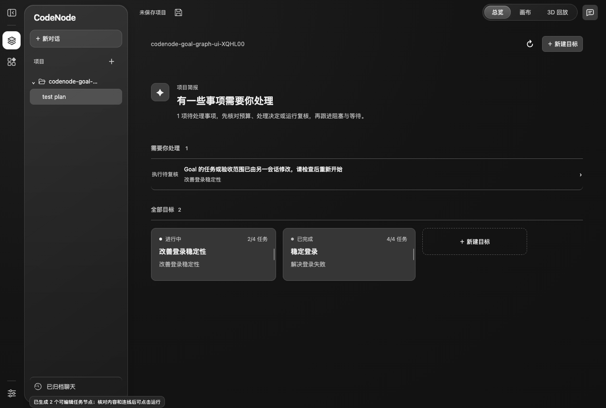
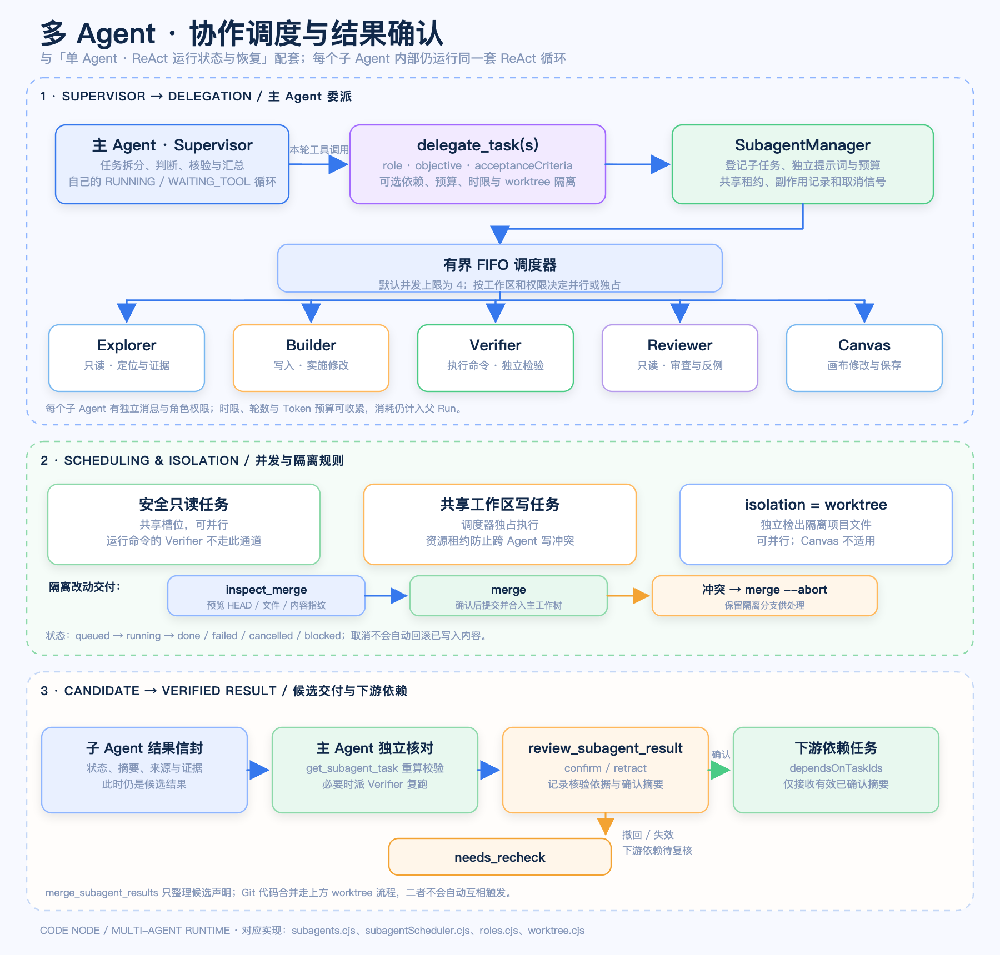

# CodeNode

[English](README.md) · [简体中文](README.zh-CN.md)

CodeNode 是一个在本地仓库里使用编程 Agent 的桌面工作台。对话用来提出问题，画布用来安排任务和依赖，运行记录用来核对 Agent 实际读了哪些文件、改了什么、测试结果如何。你可以从一句“这个项目从哪里启动？”开始，也可以把一次跨文件修复拆成多个可验收的步骤。



*2026-11-27 从合并后的桌面应用实拍。画布展示仓库自带的 workflow.cnode 示例工程。*

## 为什么使用 CodeNode

| 开发时遇到的问题 | CodeNode 如何帮你处理 |
| --- | --- |
| Agent 说“修好了”，你还需要判断能否合入 | 从对话展开文件差异，核对工具输出。在目标里写下验收条件，例如“重启后能重新打开刚保存的工程”，再根据测试结果判断是否完成。 |
| 一个需求跨好几个文件，做到一半看不清还有什么 | 把计划显示在画布上，沿依赖关系查看正在执行和等待的步骤。目标总览集中列出需要人处理的阻塞与复核事项。 |
| 连接中断，无法判断写入是否已经发生 | 运行记录保存事件、检查点与副作用账本。恢复时先核对已有结果，有疑问的写入由你复核，避免重复执行。 |
| 希望有人独立验证实现 | 主 Agent 可把定位、实现、测试和审查分给不同角色。交接时会核对产物指纹，文件变动后可以追溯哪些结论需要重验。 |

## 如何使用

在有桌面环境的电脑上安装 Node.js 22.12 或更高版本，运行以下命令启动 Vite 和 Electron。

```sh
git clone https://github.com/yimi528/CodeNode.git
cd CodeNode
npm ci
npm run dev
```

1. **打开工程。** 用项目侧栏打开源码目录，或直接打开已有的 `.cnode` 工程。第一次体验可以选择本仓库的 `workflow.cnode`，对照上图查看节点和连线。
2. **连接模型。** 从对话输入框旁的模型入口打开“模型连接”。选择服务商，按需填写 API Key，自定义服务还需填写地址。点击“连接”，从列表选模型，再按界面提示保存。若使用已安装的外部 Agent，可在后端选择器切换。[后端配置](docs/backends.zh-CN.md)
3. **先做一次能核对的任务。** 在本仓库里发送：“找到‘适应画布’按钮的实现，告诉我点它时调用哪个函数，并列出文件路径。”沿回答打开文件，就能核对 Agent 是否找对了控件。要修改时，再写明范围和验收条件。
4. **跟进多步骤工作。** 用 `/plan` 生成计划，在画布上查看步骤和依赖。需要持续跟踪时，进入“总览”并点击“新建目标”，填写目标和验收条件。执行后检查文件差异与测试输出，需要确认的操作会在界面里提示。[画布与目标](docs/canvas-and-goals.zh-CN.md)

<details>
<summary>查看计划执行时的界面</summary>



界面回归示例中，计划节点分别标明已完成、进行中和待办。Agent 同时在右侧询问先验证哪部分。

</details>



*当前版本的目标总览，使用界面回归的示例数据。上方提示哪项任务需要复核，下方卡片显示各目标完成了多少任务。*

## 技术架构

React 渲染进程负责对话、画布和目标视图，通过 preload 暴露的 IPC 接口把请求交给 Electron 主进程。以内置后端为例，主进程驱动模型请求、工具执行和运行记录，再将文本增量、工具结果和状态变化送回界面。

### 单 Agent 的 ReAct 循环


以查找“适应画布”按钮为例。模型在 `RUNNING` 决定搜索源码，运行器进入 `WAITING_TOOL`，校验参数并执行搜索，把命中位置写回上下文。下一轮模型可以读取命中的文件，再用文件内容回答。工具需要审批或补充信息时进入 `WAITING_USER`，用户答复后继续处理。最终答复、预算耗尽、运行错误和用户取消各有独立的终态。

中断后，恢复逻辑读取检查点和副作用账本，判断哪些步骤可以继续、哪些结果需要人核对。继续执行会创建新的运行，原运行仍可追溯。[运行循环源码](electron/agent.cjs) · [运行状态与恢复](docs/run-recovery.zh-CN.md)

### 多 Agent 如何协作



1. **拆任务。** 主 Agent 为每个子任务指定目标、角色和验收条件，可以声明依赖。例如，先让 Explorer 找出工程恢复入口，再由 Builder 修改，Verifier 运行回归，Reviewer 检查遗漏。Canvas 角色负责编辑画布。
2. **调度与隔离。** 每个子 Agent 都有自己的消息上下文、工具权限和预算，内部仍跑同一套 ReAct 循环。默认并发上限为 4。安全只读任务可以并行，共享工作区写任务独占执行。需要并行修改代码时，可使用独立 Git worktree。
3. **核验再交接。** 子 Agent 提交摘要、来源和产物。主 Agent 对照磁盘重算产物指纹，必要时让 Verifier 重跑测试。下游只接收已确认且仍有效的摘要。独立工作树的代码需经过合并预检和确认，发生冲突时保留工作树供复核。[调度器](electron/subagentScheduler.cjs) · [多 Agent 协作细节](docs/multi-agent.zh-CN.md)

## Agent 评测

| 日期与条件 | 结果 | 如何解读 |
| --- | --- | --- |
| 2026-11-01，脚本化模型响应，真实工具与文件操作 | 14 个场景各跑 3 次，42/42 通过 | 检验编辑、恢复、取消和预算等框架行为。 |
| 2026-11-02，冻结源码，使用真实的 `deepseek-chat` | 11 个任务各跑 3 次，32/33 通过当时的断言，整体未达标 | 人工复核发现评分器放过了一次错误的词频答案。32/33 是该评分器的通过数，不能据此推算模型回答正确率。 |

**一个可复现的修复。** 2026-11-27 在合并后的版本上单独复跑了 `edit-then-run-tests`。示例工程里的加法函数误用了减号。每轮评测都让 CodeNode 读取源码、只修改 `pkg/math.cjs`，再执行原有测试。评分器比较工作区前后差异，并独立重跑测试，核对 `add(2, 3) === 5` 等断言。三个独立工作区均通过，测试文件保持原样。这三次都把改动限定在指定文件内，修复也通过了独立复测。模型决策使用离线脚本。[任务定义与评分条件](scripts/eval/agent-eval-tasks.cjs)

用以下命令复跑这个案例。

```sh
npm run eval:agent:repeat -- --mode=offline --task=edit-then-run-tests --trials=3
```

可以用 `npm run eval:agent:repeat -- --trials=3` 在当前检出版本重跑离线回归，检查每轮的运行记录与断言。[评测方法与历史结果](docs/agent-evals-anthropic.zh-CN.md)

## 代码开发规范

| 改动内容 | 放在哪里、怎样验证 |
| --- | --- |
| 界面与交互 | React / TypeScript 组件和状态放在 `src/`。渲染进程通过 preload 暴露的 IPC 接口请求文件或系统操作。改画布交互时，在 Electron 窗口中验证实际点击、键盘操作和最终状态。 |
| 主进程与 Agent 工具 | 窗口、IPC、运行循环放在 `electron/`，工具实现放在 `electron/tools/`。工具接入现有注册与执行流程，让参数校验、权限检查和运行记录覆盖新行为。 |
| 回归测试 | 无需显示环境的用例放在 `scripts/core/`，窗口交互用例放在 `scripts/ui/`。从正常入口执行，断言用户可观察的结果。例如测试编辑工具时，读取磁盘上的文件，再独立运行项目测试并检查退出码。 |

**代码格式。** 使用 UTF-8、LF 行尾，文件末尾保留换行。TypeScript、JavaScript 和 YAML 使用两个空格缩进。修改双语文档时，同步更新两版的步骤、命令和数据。[编辑器配置](.editorconfig) · [行尾规则](.gitattributes)

**分支与提交。** 工作分支按 `<性质>-YYYYMMDD-<内容>` 命名，日期取建分支当天，内容用短横线连接的小写英文词，例如 `docs-20261127-workbench-guide`。提交标题用 `feat:`、`fix:`、`refactor:`、`docs:` 或 `chore:` 标明性质，正文说明动机和验证方式。PR 面向 `main`，附上实际执行的命令与结果。提交前排除生成的评测报告、运行日志和临时构建产物。[PR 模板](.github/pull_request_template.md)

**开发日志。** 每次改动源码、配置、脚本、测试或文档，都在 `docs/development-log/YYYY-MM-DD.md` 追加本次记录。时间按上海时区写到秒，格式为 `YYYY-MM-DD HH:mm:ss CST`。分别填写“修复的 Bug”“更新内容”“验证结果”，没有对应内容时写“无”。[日志规范](docs/development-log/README.md)

**提交前验证。** 先用 `npm run test:list` 找到受影响的用例，再执行以下检查。涉及界面、画布或 Electron 窗口时，另跑 `npm run test:display`。

```sh
npm run test:development-log
npm run verify
```

`verify` 依次执行 `npm run build`、`npm run check:js` 和 `npm test`，分别覆盖渲染层构建、主进程与脚本静态检查、核心回归。[贡献指南](CONTRIBUTING.zh-CN.md) · [文档索引](docs/README.md)

## 许可证

[Apache License 2.0](LICENSE)
