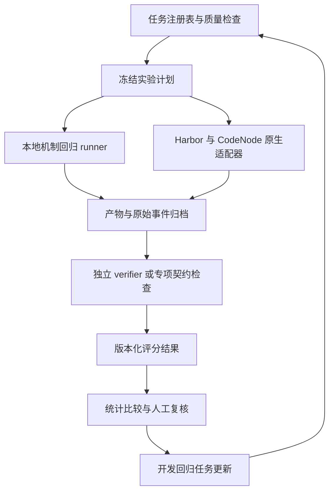

# CodeNode Agent 自动化评测体系设计

设计日期：2026-11-14。实施更新：2026-11-15。状态：P0 至 P4 的工程通道已接通；独立人审仍待完成；本地容器工程验收与专用远程评测 CI 已通过，发布检查未放行。

CodeNode 的评测体系回答三个问题：当前配置能完成哪些编码任务，遇到变化和故障时是否可靠，以及一次改动是否带来可归因的收益。采用原生离线 runner 与 Harbor 两条执行通道，共享任务契约、实验身份、预算、证据与结果协议。

操作命令、目录、真实模型诊断及当前阻碍见[运行与验收说明](agent-evaluation-operations.zh-CN.md)。三档基础 coding 任务见[编码评测说明](coding-eval.zh-CN.md)。以下设计要求继续作为验收依据，不将“代码存在”解释成“外部环境和科学结论均已验证”。

## 当前实施进展

| 阶段 | 已实现并有本地测试的部分 | 尚未满足的验收条件 |
| --- | --- | --- |
| P0 测量契约 | 26 题分类、74 个编码校准候选、坏题运行前拦截、随机盲评包与外部复核导入 | 当前任务仍未获得独立人工批准 |
| P1 统一证据 | 冻结源码与依赖、计划封印、实际请求和工具 schema、事件与终态、共享 token 账本、状态分离、断点不自动重跑 | 早期试验缺少的供应商版本等信息不回填，外部服务异常仍单列 |
| P2 独立验收 | 零模型重评及谱系、Docker 无网络只读候选后端、Harbor 分离 verifier 导出和受限 UID、产物哈希检查 | Docker daemon 已恢复；正反例、Harbor 主链路、原生 profile 与故障恢复已实跑通过，记录实际 network_mode=none；早期宿主模型成绩不回填为容器成绩 |
| P3 统计与可靠性 | 改名、改写、临时故障变体；家族权重、分块随机试验、Wilson 和重采样区间；预算内真实 pilot 与补充诊断 | 当前小样本与服务中断不足以确认收益或广泛泛化 |
| P4 运行与门禁 | 相关 PR、离线周期任务、显式启用的有预算模型任务及工件上传配置；发布检查给出拒绝原因 | 已推送 codex/agent-evaluation-ci 并通过专用远程评测 CI；未合入主分支，缺人审或充分模型证据仍不授予发布通过 |

数据集为 agent-eval-v5，基础评分器仍有 34 个正反例回归场景。当前真实模型共 29 次尝试：供应商已报告 482,782 tokens，保守计账 882,845，上限 1,000,000；不把未知计费当作零。实际报告与限制见运行说明。

## 一 测量目标和结论边界

被测对象是模型、CodeNode 运行框架、提示词、工具、权限策略、上下文处理、预算和环境组成的系统。桌面交互与 headless 编码能力分别评测；自动批准的任务不能证明审批交互正确。

| 评测轨道 | 要回答的问题 | 验收证据 | 不支持的推断 |
| --- | --- | --- | --- |
| 机制回归 | 缓存、停止、恢复、权限等机制是否满足契约 | 脚本模型驱动真实工具与事件，再断言终态 | 离线全通过不等于模型有编码能力 |
| 编码能力 | 能否定位、修复、实现并保持兼容 | 独立环境中的行为测试与受保护文件检查 | 三个小题不代表大型仓库能力 |
| 可靠性 | 重复执行、输入扰动和工具故障下如何表现 | 多次试验、成对变体、恢复结果和副作用 | 偶尔成功不等于每次可靠 |
| 产品流程 | 审批、取消、用户改动、桌面与 CLI 交付是否正确 | 专项流程测试、真实事件和产物 | CLI 通过不等于桌面产品流程通过 |
| 外部 benchmark | 固定协议下与公开任务或参考系统如何比较 | 指定版本任务、官方或适配器 verifier 结果 | 小样本子集不能作为全榜成绩 |

先定义被测能力，再选指标。例如“主动验证”属于过程行为；“代码正确”由最终行为验收决定。除非任务专门测工具契约，不要求指定工具、固定补丁文本或唯一调用顺序。

研究依据：[Agentic Benchmark Checklist 论文](https://arxiv.org/abs/2507.02825v5)强调任务设置和奖励设计本身会造成测量错误；[2026 年 10 月综述](https://citp.princeton.edu/sites/g/files/toruqf6781/files/documents/emerging-trends-paper.pdf)区分测量有效性、统计严谨性和因果归因。本设计据此将任务质量检查置于批量运行之前。

## 二 现有能力与建设缺口

| 当前实现 | 已有能力 | 本设计要求的增量 |
| --- | --- | --- |
| [agent-eval.cjs](../scripts/eval/agent-eval.cjs) | 离线与真实模型、独立临时目录、终态断言、报告和保留轨迹 | 输出统一运行身份、有效配置、分离运行状态与评分状态 |
| [agent-eval-repeat.cjs](../scripts/eval/agent-eval-repeat.cjs) | 多进程重复运行、归档工作区、pass@k 与 pass^k、拒绝源码漂移 | 区分同版本重复与跨版本比较，增加不确定性和覆盖报告 |
| [coding-tasks.cjs](../scripts/eval/coding-tasks.cjs)与[编码 grader](../scripts/lib/coding-grader.cjs) | 三档小项目任务、独立行为验收、保护公开测试、等价实现校准 | 任务规格审查、独立人工标签、真实仓库任务与可靠性变体 |
| [Harbor 接入](../benchmarks/README.zh-CN.md) | 原生 CLI、冻结源码归档、ATIF、任务与镜像记录、公共 benchmark | 将既有记录映射到统一协议，验证 verifier 隔离和资源配置 |
| [comparison.py](../benchmarks/codenode_benchmarks/comparison.py) | 固定任务、镜像、预算和参考 Agent 的成对实验 | 随机化分块顺序、重复试验、明确比较对象与统计判定 |
| [native_ab.py](../benchmarks/codenode_benchmarks/native_ab.py) | 同一运行时比较功能开关、保存中断状态 | 当前同时切换六个功能只能评价整组变化；单项归因需逐项消融 |
| [recovery.py](../benchmarks/codenode_benchmarks/recovery.py) | 部分任务从解题快照恢复评分，保留原结果 | 声明可恢复的产物契约，拒绝缺失状态的重评，连接评分版本谱系 |
| [失败归因脚本](../scripts/benchmarks/attribute-failures.py) | 从已有日志提取错误和证据位置 | 统一归因类别，区分观测、原因假设与人工确认结论 |

实现约束有两点。第一，[本地依赖](../benchmarks/pyproject.toml)固定 Harbor 0.25.0；当前在线文档中的接口不能直接假定该版本支持。第二，现有 agent-eval 的 buildConfig 对真实模型也关闭会话 compaction，并固定部分重试和生成参数。该配置适合特定回归协议，不能自动代表产品默认配置，也不能直接用于压缩开关实验。

## 三 执行架构与复用决策



Harbor 管理任务环境、试验生命周期和外部任务格式；CodeNode 保留原生提示词组装、工具注册、上下文处理、模型调用与停止逻辑。适配层只处理启动、配置传递、计账、事件映射和产物收集。禁止为了获得更高分而在适配层加入未声明的解题提示或隐藏重试。

本地离线 runner 保留，用于快速测试精确的故障注入和运行契约，不必强行转换成容器任务。两条通道共享证据与结果协议，报告始终按轨道分开。

优先复用 Harbor，暂不并行迁移到第二套执行框架。若以后需要 Inspect 的分析能力，先从只读结果导出开始。[Inspect Agent Bridge](https://inspect.aisi.org.uk/agent-bridge.html)可以接入外部 Agent，但其模型调用路由等行为也需纳入适配一致性验证，不能假定更换 bridge 后被测系统不变。

分别记录两类运行 profile：

- `native-product`：以明确版本的产品配置为基准，只声明环境必须的差异，例如 headless 与凭据注入方式。
- `benchmark-controlled`：统一预算、关闭或指定重试等条件，适合受控比较；报告完整列出相对产品配置的覆盖项。

适配一致性检查比较实际生效的提示词、工具 schema、权限、上下文和重试设置。可以替换工作区路径等无关值，但不得将语义差异归一化抹掉。检查失败时结果仅用于适配调试。

## 四 任务规格与准入规则

每个任务都登记下列信息。私有验收脚本与参考修复留在控制端，不复制给解题 Agent。

| 字段组 | 必需内容 |
| --- | --- |
| 身份与来源 | task_id、版本、内容哈希、来源、许可、仓库与基线提交、任务家族 |
| 测量范围 | 目标能力、输入契约、难度依据、允许的修改与副作用 |
| 初始环境 | fixture 或仓库快照、依赖锁、镜像 digest、准备命令 |
| 验收 | grader 版本与哈希、必需断言、受保护路径、验收时限、产物收集范围 |
| 运行条件 | profile、工具和网络权限、人工介入策略、各类预算 |
| 任务关系 | 开发集或保留集、原任务与变体关系、同源家族、已暴露范围 |
| 质量证据 | 参考修复、错误补丁、人工审查记录、已知争议 |

任务进入正式能力集前必须满足：

1. 题面包含验收所需条件，不通过隐藏的文件名或未声明格式误拒正确答案。
2. 对修 Bug 任务，初始版本在目标断言上失败，参考修复通过；对无需修改的审查任务，按其自身契约校准，不强制“初始必须失败”。
3. 至少检查一种等价正确实现和几种针对任务风险的错误实现，包括硬编码公开样例、只改表象和破坏兼容行为。
4. 由题目实现者之外的复核者确认题面与断言一致。单人开发时可先盲判补丁、再对照 grader，但记录为单人校准，不能声称独立审核。
5. 对适用任务检查修改测试、伪造成功输出、提前退出、读取答案和越界副作用。严重性由契约决定，不能只验证一个成功字符串。

当前 coding grader 保护所有初始 src 之外的文件，适用于这三个小夹具。真实编码任务可以要求新增或修改项目测试，因此只保护评测端验收及明确禁止修改的路径，不将“修改任意测试”一概判错。

候选任务先进入开发集。公开案例、调试失败及已经用于优化提示词的任务均标记为已见任务。保留集按仓库或问题家族切分，不能将同一 Bug 的改名版本拆到两边。保留集设有限访问与更新记录；反复针对它调优后，应退出保留集身份。

公共 benchmark 单独保留官方版本与原始分数；疑似训练污染和测试时检索答案分别记录。来源哈希只能证明内容身份，不能证明模型从未见过题目。

## 五 实验计划与资源约束

运行前生成不可覆盖的 experiment manifest。至少冻结：

- 问题、主指标、次指标、目标改进幅度、可接受回归幅度和判定方式。
- 任务清单、权重、家族、变体、排除项与理由，以及 grader 和数据版本。
- 各实验组的源码快照、适配器、模型标识、endpoint、profile、提示词及工具定义哈希。
- 请求参数的显式值、未发送字段、供应商默认行为和可获得的模型版本信息。
- 每题每组尝试数、执行顺序与调度随机种子、并发、最大总费用或总用量、停止规则。
- CPU、内存、磁盘、架构、镜像、网络策略、资源限制方式、缓存和预热条件。
- 模型请求、Agent 执行、setup、verifier 的独立时限；token、工具调用、轮次和重试上限。

配置身份拆成 evaluation、agent、environment 三组哈希，分别对应测量规则、被测系统和环境。同版本重复时三组必须一致；受控比较允许计划声明的 agent 字段变化，其余差异需阻断或形成新实验。冻结归档而非仅记录 HEAD，因为工作区可能有未提交改动。

重试是实验条件。传输层重试、Agent 看见错误后的恢复、整题重新尝试分别计数，并将已知消耗纳入预算。供应商账单或 usage 缺失时记录未知，不用预留额度冒充实际 token 或费用。

环境设置不仅影响稳定性，也可能改变可解策略。Anthropic 在其 Terminal-Bench 2.0 实验中观察到资源配置造成约 6 个百分点的成绩差异；这是该实验的结果，不是本项目的误差估计。[基础设施噪声报告](https://www.anthropic.com/research/infrastructure-noise)

## 六 隔离执行与持久证据

真实模型能力任务在受控容器或同等隔离环境中执行。解题端仅获得任务、公开代码和允许的工具；验收端从干净基线接收允许的产物，使用控制端的评分脚本。当前本地临时目录 grader 是受控夹具方案，不是宿主机安全边界。[Harbor 独立 verifier 文档](https://docs.harborframework.com/tasks/separate-verifier)提供了可复用的环境与产物传递机制，具体接入以固定版本 smoke 验证为准。

独立 verifier 环境只能隔离解题阶段的修改，候选代码在验收时仍是不可信代码。自建 grader 应将候选运行与最终计分写入分开，限制其文件和网络权限，并测试伪造输出及破坏测试运行器的情况；仅换一个容器不能证明评分无法被绕过。公共 benchmark 保留其原始协议与分数，发现绕过风险时另记完整性问题。

每个 trial 归档如下内容；这是目标布局，不是已经新增的 CLI 或存储格式：

```text
out/evals/<experiment>/
  manifest.json
  tasks/<task>/spec.json
  trials/<trial>/
    identity.json
    effective-config.json
    requests.jsonl
    events.jsonl
    native/                 # 原生 JSONL 和 ATIF 等原始日志
    artifacts/              # 补丁、新增文件或任务声明的状态产物
    artifact-manifest.json  # 文件哈希、来源、收集时点与范围
    execution.json
    grades/<grade-id>/      # grader 身份、断言、stdout、stderr
  reviews/
  summary.json
  summary.md
```

请求记录保存实际发送的消息、工具 schema、生成参数和框架注入提示；只记录供应商实际暴露的信息，不假定能获得内部推理。对 Authorization、cookie、凭据及敏感字段做脱敏。哈希基于脱敏后的可审计语义输入，并声明哪些字段被移除；凭据不参与身份计算。

保留原生事件，ATIF 作为互操作视图，不能因转换格式丢失 CodeNode 的停止、压缩、审批和预算事件。[Harbor ATIF 文档](https://docs.harborframework.com/agents/atif)说明其轨迹交换用途。

trial 身份在模型调用前落盘，状态用原子写入更新。中断后先核查已有执行和产物，不能因为缺少完成标记就再次付费调用。新的尝试和评分都使用新身份并关联父记录；旧记录保留。

凭据通过进程或沙箱的受控通道注入，不进入任务快照和归档。原始代码产物与日志按访问权限保存；镜像快照的清理前提是确认后续验收所需状态已归档，记录保留期限和清理日志。

## 七 运行状态 评分和完整性分别表达

每次尝试至少有三个独立结果维度：

| 维度 | 目标状态 | 含义 |
| --- | --- | --- |
| execution_status | COMPLETED、BUDGET_EXHAUSTED、CANCELLED、AGENT_ERROR、INFRA_ERROR、UNKNOWN、NOT_STARTED | 执行如何结束或为何没有开始 |
| grading_status | PASS、FAIL、ERROR、NOT_RUN | 最终产物通过、断言失败、评分异常或未评分 |
| integrity_status | CLEAN、VIOLATION、UNKNOWN | 是否满足受保护文件、边界和证据完整性契约 |

工具调用的 ok 与命令 exitCode 仍作为事件字段保存。例如成功启动测试但 exitCode=1，表示程序执行成功地暴露了 Bug；不能记成任务已失败，也不能记成测试通过。

定义两种主要结果，不强行压成同一分数：

- 产物验收结果：指定 grader 对冻结产物的 PASS 或 FAIL，并保留运行状态。公共 benchmark 按官方协议报告原始 reward。
- 端到端交付结果：默认要求 execution_status=COMPLETED、grading_status=PASS、integrity_status=CLEAN。若任务允许预算停止时提交补丁，必须在任务契约中提前声明替代交付规则。

因此预算耗尽但补丁正确可以同时显示“产物通过、交付未完成”。完整性违规不因行为测试通过而消失。自动校验 partial、模型宣称完成和独立验收 PASS 也分别保留。

另行维护 task_validity：VALID、DISPUTED、INVALID。任务或 grader 缺陷与 Agent 篡改测试不同，后者属于候选违规，不能用“任务无效”将失败从分母删除。事后发现任务问题时保留原成绩，公开适用于所有组的修正理由，并生成新版本评分及敏感性分析。

基础设施错误保留发生阶段、原始异常与证据。明确的预算限制导致超时或 OOM 不自动归为无关故障；未知中断保持 UNKNOWN。不能仅靠日志关键词决定免责或重新运行。

## 八 独立评分与评分器校准

评分优先使用可执行行为断言，再检查接口、兼容性和允许副作用。文件文本及指定调用次数用于明确的契约测试；对编码能力任务允许等价实现。要求“主动运行测试”时，将其单独列为过程契约，不能用模型自述或孤立的输出标记代替执行证据。

先做评分器自己的测试，再批量测 Agent：

| 校准类别 | 预期 |
| --- | --- |
| 参考修复、独立的等价修复、合理辅助文件 | 接受 |
| 初始 Bug、公开样例硬编码、部分实现、兼容性回归 | 拒绝 |
| 篡改受保护验收、伪造标记、提前退出 | 拒绝或明确记录完整性违规 |
| 评分环境无法启动、评分器崩溃或其结果格式损坏 | 评分异常，不伪装成代码断言失败 |

超时按原因和任务契约判定：候选实现违反已声明的执行时限可判 FAIL；评分器自身故障或依赖准备超时记 ERROR。不能把死循环等实现错误统一当作评分基础设施异常。

建立人工标注的补丁校准集，记录“误收错误实现”和“误拒正确实现”的次数、分母、争议案例及证据。当前 34 个基础场景属于回归资产，不能作为 grader 对未知实现完全有效的证明。审查者尽可能不看模型或实验组标签。

LLM judge 仅在可执行测试不足的维度使用，例如解释是否覆盖约束；保存 rubric、judge 模型版本、输入、输出和证据。先用独立人工标签验证误判情况，版本比较中固定 judge。自动归因是候选标签，严重问题与抽样成功案例进入人工复核。

评分更新时对所有比较组的冻结产物使用同一 grader 版本，并保留原结果。评分规则改变不能直接拼接为同一时间序列；需要重评相同产物或用共同锚定任务说明差异。

## 九 可靠性任务和失败归因

[Towards a Science of AI Agent Reliability](https://arxiv.org/abs/2602.16666v3)区分一致性、鲁棒性、可预测性和安全性。CodeNode 先实施下表中的可测部分，不将它们任意加权成一个综合可靠性分。

| 维度 | 任务设计 | 输出 |
| --- | --- | --- |
| 一致性 | 每题独立初始化，多次执行同一配置 | 成功次数、尝试数、任务级波动及 pass^k |
| 鲁棒性 | 语义等价需求改写、文件改名、无关文件、声明范围内的工具暂时故障 | 原题与变体成对结果、成功率变化、额外消耗 |
| 失败预警与报告 | 对照实际状态检查最终答复及可获得的运行信号 | 错报完成、遗漏失败、证据过期；无概率输出时不声称校准了置信度 |
| 副作用和失败严重性 | 用户已有改动、受保护文件、禁止写入位置与停止要求 | 不变量违规次数、严重程度、恢复后的完整性 |

变体需要重新确认可解性与语义等价，不能把功能要求改变当作无害扰动。故障注入的时间和条件在计划中固定，例如首次读取失败，而非根据某个实验组表现临时选择。

归因分三层保存：可观测事实、原因假设、确认状态。例如“ARG_SCHEMA 后换用 argv”是事实，“工具说明不充分”是待验证假设，“增加示例减少此类错误”需要对照实验。分类至少覆盖定位、实现、回归、工具契约、上下文、预算、任务或评分器缺陷、环境与未知；允许多标签，不强制单一根因。

## 十 指标 分母与统计判定

报告先展示计划数、启动数、完成数、可评分数、异常数和排除数，再展示分数。主表按能力轨道及任务家族分开；权重在运行前固定，避免靠增加大量简单变体抬高均值。

| 指标 | 定义与解释 |
| --- | --- |
| 保守交付比例 | 已确认端到端交付次数 / 全部计划次数；未执行和未知项不算成功。这是当前证据的保守比例，不等于模型能力成功率 |
| 可评分尝试的产物通过率 | PASS / (PASS + FAIL)，同时显示分母和缺失覆盖；不能据此隐藏评分异常 |
| 任务等权 pass@1 | 先计算每题有效尝试成功率，再按预定权重聚合。缺失结果存在时只报覆盖子集估计，另报全计划保守比例 |
| pass@k 与 pass^k | 分别表示 k 次中至少一次成功、k 次全部成功；k 不超过可用次数，不以 pass@k 证明单次交付可靠性 |
| 资源消耗 | 所有已启动尝试的输入、输出、缓存命中、辅助调用、失败请求、耗时和已知金额；未知量与已知量分开 |
| 稳定性与风险 | 参数拒绝、重复调用、工具故障恢复、虚报完成、完整性违规和严重程度 |

沿用每题 n 次、c 次成功时的估计：`pass@k = 1 - C(n-c,k)/C(n,k)`，`pass^k = C(c,k)/C(n,k)`。只有缺失处理和尝试可交换性条件成立时才聚合；环境、模型版本或配置中途变化应分批。

统计分析区分两个问题：

1. 固定任务集上再跑一次会怎样：估计各任务内的运行波动。若任务只跑一次，不声称测得了其随机稳定性。
2. 换一批类似任务会怎样：还需要考虑任务采样与家族相关性。少量相关任务跑很多次不能提供广泛泛化证据。

版本对比以相同任务为配对单位，报告每题差值、由失败变成功及由成功变失败的清单。对固定任务集，可在各题各组内重采样尝试，保持任务集合固定；对明确的任务总体推断，可按预先声明的仓库或问题家族聚类重采样，并在任务内重采样尝试。此处是本项目选择的区间估计方案，需用模拟与覆盖检查验证；家族太少时只做描述性报告，不给出貌似精确的泛化区间。

每题每组三次仅作为 pilot 起点，不能作为统一样本量标准。pilot 用于估计方差、耗时和费用；正式实验根据目标差异和预算预先确定任务数、重复数及停止规则。设主指标、最小有意义收益和最大允许回归；区间或样本不足以支持判断时输出“证据不足”，不等同于“没有差异”。

实验组执行顺序在任务与轮次内分块随机化，保存调度种子和实际顺序。云端模型的随机种子不保证严格复现，也不让两个组天然成为同一随机轨迹。不能在看到结果后不断加跑直到显著；探索多个功能时，区分探索与确认实验，并处理多重比较。

以上统计范围对应[2026 年综述中的统计与归因讨论](https://citp.princeton.edu/sites/g/files/toruqf6781/files/documents/emerging-trends-paper.pdf#page=12)。具体采样数、区间方法和门禁阈值是项目实验决策，并非某篇论文规定的通用标准。

## 十一 重评 恢复和结果审计

重评只更换 grader，保持候选产物不变。要求基线、产物哈希、原始任务和 verifier 所需全部状态可验证；不能只凭 patch 重评依赖数据库、后台服务或进程状态的任务。无法重建时记录不支持重评，不能偷换成重新解题。

每份新评分记录 parent_trial_id、parent_grade_id、grader_id、变更理由、输入哈希和完整输出。原始公共 reward、修正评分和恢复评分分别展示，不覆盖原值。[Harbor regrade 文档](https://docs.harborframework.com/jobs/regrade)也要求已收集产物足以支持新的 verifier。本项目先复用既有 recovery，再验证固定 Harbor 版本是否具备适用的原生接口；升级框架时先运行适配 smoke，形成新的环境身份。

基础设施重试须有预设资格和上限。模型可能已经执行、计费或修改状态时，原尝试保留；重启作为新尝试关联，而非删除失败。只有能证实尚未执行 Agent 的 setup 故障才进入准备恢复流程。报告列出原始结果与预先定义的恢复后视图，禁止挑选最好的一次。

历史报告中的缺失字段设为 unavailable，不从当前源码推断历史有效配置。日志与产物能支持重新评分和审计，不保证未来供应商调用逐字复现。

## 十二 自动运行与发布决策

| 触发条件 | 内容 | 默认决策 |
| --- | --- | --- |
| 每次相关 PR | 机制回归、任务准入、grader 校准、证据协议与适配单测 | 确定性契约失败阻断 |
| 模型调用或工具相关 PR | 固定的小型真实模型回归子集 | 初期生成报告，达到足够稳定性后设置明确门禁 |
| 定期完整运行 | 能力开发集、可靠性变体、重复试验、失败复核 | 提交趋势与异常，不自动宣称能力提升 |
| 发布或确认实验 | 冻结保留集与真实仓库任务，必要时外部 benchmark | 按预先声明的回归幅度、覆盖和完整性规则决定 |

确定性机制测试必须通过；真实模型一次失败先保留证据和归因，不能盲目重跑到绿。高严重度违规可独立触发发布阻断；概率型能力变化依据确认实验判断。基础设施或证据缺失导致无法验证时标记“未验证”，不授予通过状态。

报告输出任务清单、版本身份、配置差异、完整分母、成功与回归明细、消耗分布、区间与假设、失败证据入口。人工复核所有新失败和严重异常，并抽样成功案例；控制端保存未抽中的总体，避免只看失败而漏掉假通过。

自动化首先落在现有 CI 与手动实验入口，不将该设计视为已经部署的定时服务。数据量增长后再增加索引或仪表盘，原始 JSONL 与产物仍为审计依据。

## 十三 分阶段实施与验收

| 阶段 | 具体改动 | 完成标准 |
| --- | --- | --- |
| P0 测量契约 | 给现有任务标轨道和范围；新增任务准入、人工校准、实验与结果 schema；审查历史配置差异 | 修复题初始失败与参考通过可复跑；错误补丁被拒；现有机制 PASS 不被误标为能力 PASS |
| P1 统一证据 | 将本地 runner 与现有 Harbor 记录映射到协议；保存有效配置、schema、预算与原始事件 | 使用脚本模型走通两个通道；中断不自动重启；缺证据不假绿；凭据不出现在归档；配置差异可审计 |
| P2 独立验收 | 在固定 Harbor 版本验证隔离与产物传递；扩展既有 recovery；记录评分谱系 | 成功与错误候选分别得到预期分数；候选无法修改控制端验收；重评不发模型请求；缺状态明确拒绝 |
| P3 统计与可靠性 | 任务家族、变体、重复尝试、分块顺序、区间与费用预算 | 模拟数据验证分母和区间行为；原题与变体语义复核；小样本输出证据不足；完成一次受控 pilot |
| P4 确认与运行 | 冻结保留集、设置门禁、接入相关 PR 与定期运行 | 可从报告找到每项结论的证据；确认实验符合预设规则；回归与基础设施异常均不会消失 |

每阶段只运行与改动范围匹配的验证，并追加开发日志。涉及源码时保留现有命令作为回归入口：

```bash
npm run test:coding-grader
npm run test:agent-eval-repeat
npm run test:eval
npm run test:benchmark-profile
npm run test:benchmark-adapter
npm run test:development-log
```

容器能力由对应 benchmark smoke 验证；实际模型费用和统计结论由正式运行验证。设计文档通过链接和格式检查，不等于上述目标能力已实现或实测。

## 十四 首个对照实验

第一个实验检验“给 execute_shell 增加清晰的 argv 示例是否改善调用”，复用已发现的真实现象，避免同时改动模型或运行框架。

1. 先核对实际发送的工具说明与 schema；确认示例是否已经存在，避免基于不完整轨迹修改。
2. 在开发集建立包含直接执行、参数转义、复合命令需求与错误恢复的任务，验收正确行为而非强制唯一工具序列。
3. 固定模型、grader、环境、权限、恢复提示和预算，仅改变说明中的目标部分。若改动 schema 或执行行为，另立实验身份。
4. 主指标为首次相关 shell 调用的参数契约拒绝比例；分母为发生适用调用的尝试，另报未调用覆盖。端到端交付率作为必须保护的结果，额外报告 token 和耗时。
5. pilot 每题每组三次仅用于估计；正式计划冻结样本量、实际收益阈值与允许回归后再运行，且保留调用序列和框架提示。
6. 用未参与说明调优的保留任务确认结果。当前六功能整体 A/B 的结果可作探索线索，不能替代这一单变量实验。

完成后应能明确回答：哪类任务减少了参数错误，是否引入回归，改善是否超出本次样本的不确定性，以及增加的说明是否带来值得接受的消耗。
