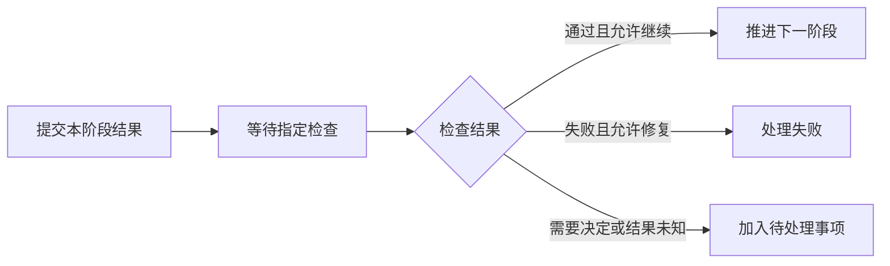

# CodeNode 借鉴 Super-agent 的产品与架构方案

日期：2026-11-17。版本：第二版，待实施。

CodeNode 可以借鉴 Super-agent 的五个思想：接话与执行分开、围绕任务持续跟进、由事件推动后续工作、减少对人的打扰，以及按“现在等谁”呈现状态。

建议将这些思想落实到现有对话、Goal、Task、Run 和总览中。最先解决两个体验问题：后台干活时用户仍能交代事情；用户回来后能直接知道结果和需要自己处理的事项。技术改动随具体体验逐步确定。

## 一 借鉴什么以及为什么

| Super-agent 的思想 | 解决的用户问题 | CodeNode 的借鉴方向 | 优先级 |
| --- | --- | --- | --- |
| 总管接话，执行者干活 | AI 忙起来以后，用户难以补要求或交代下一件事 | 建立持续可用的交流入口，把执行进度与当前对话解耦 | 最高 |
| 一项任务持续存在 | 测试、追问、返工分散在多轮会话中，用户反复交代背景 | 以任务串起需求、决定、历次执行和验收 | 高 |
| 收到相关事件后继续 | 用户要盯着测试和审查结果，反复说“继续” | 在已有授权和预算内，由等待条件、回答和检查结果触发下一步 | 高 |
| 尽量少占人的注意力 | 用户要阅读大量过程消息，频繁回答本可自行查清的问题 | 正常过程安静记录，结果、决定和实际阻塞集中呈现 | 最高 |
| 面板围绕人的下一步组织 | 状态很多，用户仍不知道现在该做什么 | 显示谁在等谁、为什么等，以及一个明确动作 | 高 |

这些是从 Super-agent 设计中提炼出的借鉴点。下文的产品交互、优先级和技术取舍，是面向 CodeNode 的建议。Super-agent 官方仓库将其定位为研究原型，文章中的部分设想尚未实现；不能据此假定它已经验证了全部效果。[官方说明](https://github.com/deepseek-ai/dsh-superagent-prototype)

## 二 接话与执行分开

### 借鉴的思想

Super-agent 区分负责接收和协调请求的总管，以及处理具体工作的执行者。对用户最有价值的是：后台任务耗时再长，仍然有地方可以交代事情。[执行设计](https://github.com/deepseek-ai/dsh-superagent-prototype/blob/main/docs/003-execution.md)

### CodeNode 应该怎么做

用户在任务运行期间，可以继续做四件事：追加要求、询问进度、提交下一项任务、停止指定任务。每次输入都应明确归属哪件事，并给出准确回执。

例如，登录任务正在跑测试时：

- “旧账号也要能登录”归到登录任务。
- “现在做到哪了”读取登录任务最近的真实进度。
- “再检查一下打包失败”建立另一项任务，可以先排队。
- 在登录任务卡上点击停止，只停止这项任务。

接收新任务与立即执行分别显示。首版可以保持一个写任务执行，同时接收后续任务；用户仍能获得随时交代事情的体验。

### 现有基础与改进点

当前工作区已有内置 Agent 插话、取消和 Run 记录。主要限制是普通聊天发送有全局忙碌守卫，Goal 调度仍通过前端会话发起执行；插话默认指向最近请求，并使用内存队列。

技术上需要显式绑定输入与任务、保存尚未送达的要求，并逐步让任务执行不依赖当前聊天页面。进度查询优先读结构化记录，不必让执行者额外写一轮总结。是否需要一个专门的总管模型，取决于实际路由歧义；明确归属、查状态和停止可用程序处理。

### 判断有没有做好的标准

长任务运行期间，用户仍能提交要求；消息不会送错任务；界面能区分“已保存”“已交给执行者”和“本后端将在本轮结束后接收”。

## 三 围绕一件事持续跟进

### 借鉴的思想

Super-agent 以持续存在的工作项跟踪请求、执行、后续消息和交付。任务不会因为一次回复结束就失去关联。[执行与任务生命周期](https://github.com/deepseek-ai/dsh-superagent-prototype/blob/main/docs/003-execution.md)

### CodeNode 应该怎么做

把用户交代的“一件事”作为稳定入口，集中展示四类信息：当前目标和要求、已经作出的决定、执行与结果、尚未完成的验收或阻塞。

例如“修复登录问题”可以跨越定位、修改、测试失败、补充兼容要求、返工和最终验收。用户在这条任务里点击“继续修改”，应沿用相关上下文，并核对当前代码与历史结果是否仍一致。

任务卡显示最新结论，详情保留历史依据。用户无需先记住它属于哪个会话、哪个 Run，才能继续跟进。

### 现有基础与改进点

CodeNode 已有 Goal、Task、Run、阶段交接、交付卡与证据失效机制。现有关系可以直接作为基础：Goal 表示整体目标，Task 表示一件工作，Run 表示一次执行。

改进重点是让普通对话中的工作也能持续关联，并让后续消息自然回到对应任务。闲聊和一次性问答不必强制建任务；明确要持续执行、排队或跟进的工作才需要任务身份。普通任务不自动获得 Goal 验收资格。

### 判断有没有做好的标准

隔天回来后，用户打开任务即可看懂做到哪里；追加要求能找到原任务；一次 Run 结束不会被误报成全部需求完成。

## 四 让相关事件推动下一步

### 借鉴的思想

Super-agent 会把相关线程中的后续消息和外部结果送回工作项，执行者据此继续处理。任务可以经历工作、等待和恢复，而不要求人始终盯着。[事件与执行跟进](https://github.com/deepseek-ai/dsh-superagent-prototype/blob/main/docs/003-execution.md)

### CodeNode 应该怎么做

先完善已经明确的等待链路。例如：

适合优先支持的触发包括：指定提交的 CI 完成、已配置的评测返回、用户回答了业务问题，以及明确等待时间到达后重新检查条件。

每个触发都回答三个问题：是否属于这项任务、能否据此做下一步、下一步有没有既有授权和剩余预算。到达检查时间只表示应当检查，不代表条件已经满足。外部消息只提供事实，不扩大任务权限。

### 现有基础与改进点

CodeNode 已有 Goal 等待、GitHub Actions 和 Agent Eval 检查、预算限制及自动推进。这里适合继续完善已有能力：把等待原因和恢复结果展示清楚，让相关事件稳定接回原任务。

自动继续的范围需要明确。已授权流程内的检查和后续阶段可以推进；新增目标、扩大写入范围、未知副作用和需要业务选择的情况，进入原有复核或决定流程。自动接收所有仓库事件不作为首期目标。

### 判断有没有做好的标准

用户不用重复说“继续”；过期、重复或属于其他提交的事件不会错误启动任务；等待恢复不会绕过已有预算、权限和验收规则。

## 五 把少占用户注意力作为设计原则

### 借鉴的思想

Super-agent 明确要求尽可能少占用人的注意力。消息、问题、设置和面板元素都需要证明自己的价值；正常工作尽量保持安静，结果、决定和无法完成的情况再找人。[设计原则](https://github.com/deepseek-ai/dsh-superagent-prototype/blob/main/docs/000-philosophy.md)

### CodeNode 应该怎么做

将信息按用户当下能做什么来安排：

| 信息 | 建议呈现方式 |
| --- | --- |
| 正常读文件、改代码、跑测试 | 记录在任务详情，保留可展开的实时进度 |
| 已有可使用的交付结果 | 给一次简短交付提醒，链接结果与验证记录 |
| 需要选择、授权或补充信息 | 显示具体问题和直接操作入口 |
| 已确认失败或无法继续 | 说明影响、保留的结果和可采取的下一步 |
| 会自动重试的短暂网络错误 | 留在详情，持续影响任务时再提示 |

询问用户之前，先检查工程文件、已有决定和当前上下文能否解决。确实缺少信息时，一次问一个会影响下一步的具体问题。用户原有授权继续有效，不能每轮重新询问。

过程可见与主动打扰分别控制。想看细节的用户随时能展开记录，默认无需处理每条工具事件。减少通知也不能隐瞒失败、未知结果或持续停滞。

### 现有基础与改进点

现有总览、交付卡和运行回放已经提供承载位置。优先统一通知规则、相同阻塞去重、精简默认显示内容，并审查重复提问，而不是先扩展更多设置。

衡量效果时，除了任务通过率和费用，再记录每项任务的用户介入次数、可避免的重复提问、重复通知，以及用户找到下一步操作所需时间。介入次数需要结合任务类型比较，不能以少提问为理由猜测业务决定。

### 判断有没有做好的标准

相同难度的任务，在完成质量不降低的情况下，用户更少介入，且更容易知道实际结果。用固定任务集比较修改前后表现；数值门槛在取得基线后制定。

## 六 按现在等谁来解释状态

### 借鉴的思想

Super-agent 面板优先回答“有什么需要我”“系统是否正常”“这件事之前发生了什么”，并按工作项正在等待什么来解释状态。[面板设计](https://github.com/deepseek-ai/dsh-superagent-prototype/blob/main/docs/005-panel.md)

### CodeNode 应该怎么做

用户可见状态使用容易理解的语言：

| 状态 | 要一起说明什么 | 下一步 |
| --- | --- | --- |
| 正在处理 | 最近已确认的进展与更新时间 | 用户可补充或停止 |
| 排队中 | 等待哪类执行资源 | 资源可用后检查准入 |
| 等检查结果 | 等哪个提交、哪项检查 | 收到匹配结果后再判断 |
| 等你回答 | 一个具体问题 | 回答后重新判断能否继续 |
| 等你授权 | 哪项动作需要许可 | 沿用既有授权入口 |
| 待确认结果 | 产物及已执行、未执行的验收 | 查看交付或继续修改 |
| 需要复核 | 失败、未知结果或失效证据及影响 | 定位对应处理入口 |

这些是面向用户的显示状态，应由底层事实推导。它们不替代 Run 和 Goal 的严谨状态，也不通过一条“完成了”的模型回复判断成功。

首页继续使用现有总览，先列需要人处理的事项，再提供正常任务概况。待办按钮应直接打开对应问题、授权、交付或复核位置，避免用户重新搜索整段聊天。

### 现有基础与改进点

`goalAttention.ts` 和 `GoalOverview.tsx` 已实现部分思想，适合扩展到普通任务及后端输入请求。相同问题在总览、任务详情和对话里应有一致状态与动作；不能维护三套各自变化的结论。

### 判断有没有做好的标准

用户打开总览后能快速回答“我现在要做什么”；同一问题只出现一次；待办数量与可打开的完整列表一致。健康状态不占据大量面板空间。

## 七 如何分批借鉴

| 批次 | 产品改进 | 所需技术支撑 | 验收重点 |
| --- | --- | --- | --- |
| 第一批 少打扰且看得懂 | 统一状态用语、阻塞动作、通知与交付提醒 | 复用现有待办投影和交付事实，补充去重与一致展示 | 下一步清楚，失败不被隐藏，重复通知减少 |
| 第二批 随时接话并持续跟进 | 运行中接收明确目标的补充、查询和新任务；后续要求回原任务 | 任务与输入绑定、持久投递、执行与当前对话解耦 | 不串任务、不丢要求；排队与执行明确区分 |
| 第三批 少盯进度 | 明确等待原因，相关结果到达后按授权继续 | 完善现有等待调度、事件关联、去重和恢复 | 无需反复催促，重复事件不重复执行 |

“接话与执行分开”是核心架构方向，但完整落地涉及执行生命周期。第一批可先交付低风险、可独立验证的改进，并为第二批采集交互基线。第一、二批稳定后，再评估是否需要同时运行更多顶层任务。

技术设计遵循四个约束：复用 Goal、Task、Run 的事实来源；未确认投递不宣称执行者已收到；外部后端不支持运行中插话时明确显示下一回合处理；未知副作用按原恢复规则复核。

## 八 借鉴边界与整体评估

首期范围是应用运行、项目已打开时的工作协作。全天监听飞书、跨项目自动接活、自动提交合并，以及更多 Agent 层级，都需要各自的需求与效果依据，暂不加入本方案。

Super-agent 的总管可以先体现为协调职责和交互入口。程序能确定处理的事情直接处理，有歧义的自然语言才考虑模型。减少用户操作不能以隐性增加大量模型调用、放宽权限或牺牲验收换取。

整体评估采用相同起始项目、任务、验收要求和可比预算，比较以下结果：需求通过率、用户介入次数、重复交代背景的次数、误投或丢失要求的次数、重复通知、用户找到待处理动作所需时间，以及模型费用。确定性回归中误投、丢输入和重复启动必须为零；真实任务评估分别报告样本规模和具体失败，不能用测试脚本通过率代替自主解题能力。

本方案对应的内部基础见 [目标与总览](../canvas-and-goals.zh-CN.md)、[多 Agent](../multi-agent.zh-CN.md)、[运行恢复](../run-recovery.zh-CN.md)、[任务交付](../task-delivery.zh-CN.md)与 [后端契约](../backends.zh-CN.md)。本轮交付为方案重写，产品与架构改动按后续批次实施。
